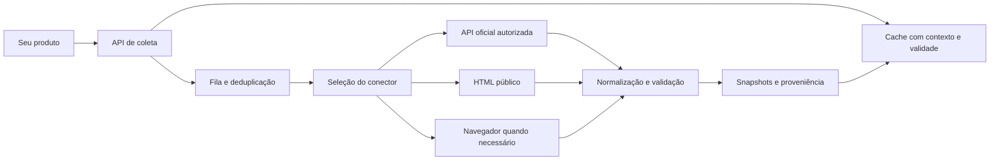

# GeckoAPI: engenharia reversa observável e uma camada própria

Investigação em 15/11/2026. Objetivo: entender a interface pública da Gecko e definir uma alternativa independente para Mercado Livre, Amazon, Magazine Luiza, Shopee, AliExpress e Temu. Este documento distingue observação direta, declaração da documentação e proposta de arquitetura.

## Resultado

É possível construir uma camada própria de coleta e normalização. O material examinado indica uma combinação de contratos HTTP, seleção de coletores por fonte/operação, parsing e enriquecimento. Não foi encontrada evidência de uma credencial universal que libere esses marketplaces.

A conclusão mais forte é documental: o PDP do Mercado Livre diz que lê páginas públicas e não substitui autorização de vendedor; a documentação da Shopee descreve extração a partir do HTML. Não é necessário reproduzir o dashboard da Gecko para desenvolver conectores próprios. [Mercado Livre PDP](https://geckoapi.com.br/docs/mercadolivre-com-br-pdp/), [Shopee PDP](https://geckoapi.com.br/docs/shopee-com-br-pdp/)

Consegui extrair título, preço exibido e disponibilidade de uma página Amazon diretamente, sem Gecko. Isso comprova uma extração parcial naquela amostra. Não comprova cobertura de catálogo, estabilidade, preço final de checkout ou paridade com a Gecko nos seis sites.

## Instalação do REA e verificação

O plano aprovado foi aplicado: REA 6.9.0 registrado em `/Users/gabriel/.codex/config.toml`, backup em `/Users/gabriel/.codex/config.toml.rea.backup`, skill versão 62 instalada em `/Users/gabriel/.agents/skills/reverse-engineer-anything`.

O registro usa Node 24.22.1 e REA no cache do npx em `/Users/gabriel/.npm/_npx/601460e880692d90/node_modules/`. O Node ativo do projeto não foi substituído. Não apagar esse cache enquanto o registro depender dele; se o cache for removido, refazer o setup com uma instalação disponível.

Verificações executadas:

| Verificação | Resultado |
| --- | --- |
| `rea setup --client codex --yes --json` | `status: ready`; configuração e skill aplicadas |
| `rea doctor --client codex --skill --json` | `healthy: true`; registro e skill `aligned` |
| `rea mcp doctor --json` | `healthy: true`; servidor 6.9.0, 255 ferramentas, 6 prompts, identidade e fluxo `binary_session` verificados |
| Captura REA do dashboard | Concluída; perfil temporário encerrado pelo REA |
| Análise estática REA do JavaScript da documentação | Um arquivo analisado, 3.688 nós AST visitados, 19 findings; relações conservadoras/parciais |
| Análise estática REA do bundle principal do dashboard | Parcial: limite de heap de 1.024 MiB atingido; arquivo não analisado semanticamente |

Um teste anterior com cliente MCP Python ad hoc atingiu seu prazo de 45 segundos em `binary_session`. O diagnóstico oficial posterior passou nessa chamada. Esse teste ad hoc não é usado para afirmar defeito do servidor nem para substituir a evidência do diagnóstico oficial.

As ferramentas novas não apareceram automaticamente no catálogo deste chat. A investigação continuou pela CLI registrada, que funcionou. Reiniciar/reconectar o Codex é o passo restante para carregar o MCP na interface do agente; não é requisito para ler estes resultados.

## O que foi examinado

Foram obtidos homepage, documentação de sete operações, HTML inicial do dashboard e quatro scripts públicos de primeira parte. O manifesto preserva URL, status, tamanho e SHA-256. Não houve criação de conta, uso de chave da Gecko ou execução de extração autenticada no serviço.

Artefatos locais desta investigação:

- [Manifesto dos downloads](/Users/gabriel/.codex/visualizations/2026/11/15/01a1e020-4731-7553-a47b-b89b15b60dd4/gecko-api/public-artifacts-manifest.json).
- [Índice de evidências REA](/Users/gabriel/.codex/visualizations/2026/11/15/01a1e020-4731-7553-a47b-b89b15b60dd4/gecko-api/evidence-index.json).
- [Trechos estáticos do dashboard, com offsets](/Users/gabriel/.codex/visualizations/2026/11/15/01a1e020-4731-7553-a47b-b89b15b60dd4/gecko-api/dashboard-static-findings.json).
- [Experimento HTTP nos seis marketplaces](/Users/gabriel/.codex/visualizations/2026/11/15/01a1e020-4731-7553-a47b-b89b15b60dd4/gecko-api/marketplace-http-probes.json).

Evidências REA completas:

| ID | Objeto e limite |
| --- | --- |
| `ev_72468b6df603d18e05f2ba2b852a34cdf5772723b8012325054f5c3a4ba2c8fb` | Captura controlada de uma abertura do dashboard; 29 transações observadas; terminou em `/login`; não observa execução autenticada de scraper |
| `ev_cea8ddcf42ccbe3619b84cf3354d74c5c077095b58d2df60ff458e77d5ad0016` | Análise estática do script público da documentação; não executou esse código |
| `ev_32801c4659eb12886fb635c6725bf5b6c2d586fc486128df0f5dd244931722eb` | Tentativa de análise do bundle do dashboard; cobertura insuficiente por memória; não fundamenta conclusões semânticas sobre ele |

Os trechos do bundle descritos abaixo foram inspecionados como texto com ferramentas comuns, independentemente da tentativa REA que atingiu o limite. Ausência de uma string em um único bundle não demonstra ausência de uma tecnologia no backend.

## Como a Gecko funciona, até onde as evidências permitem afirmar

| Camada | Evidência | Interpretação |
| --- | --- | --- |
| Website e documentação | Recursos sob `/_astro/`; respostas HTTP identificadas como AmazonS3 | Compatível com frontend estático gerado com Astro e entrega via S3; não determina infraestrutura dos coletores |
| Dashboard | Bundle público contém React, configuração de Cognito e cliente Axios | O cliente tem autenticação e chama uma API separada; isso não revela os algoritmos no servidor |
| Entrada REST | Documentação usa `POST /v1/extract`, com `target` e `type` | Interface comum para fontes e operações diferentes |
| Entrada MCP | Tools dedicadas fixam `target` e `type` | Outra interface para os contratos de extração, não uma fonte adicional de dados |
| Execução | Documentação diferencia gateway, worker, provider/proxy e erros de invocação | Sustenta uma separação de componentes; linguagem, provedor e topologia exatos permanecem desconhecidos |
| Coleta e parsing | Shopee documenta HTML bruto; Mercado Livre PLP distingue estado estruturado e fallback HTML | Há parsers específicos; não basta uma API oficial genérica para reproduzir a cobertura |
| Enriquecimento | Magalu documenta consultas adicionais de loja e prazo de 20 segundos para seguidores | Parte dos campos exige múltiplas aquisições; falha complementar pode preservar o produto |
| Lotes | Workflows documentam tarefas, deduplicação, progresso e JSON/CSV | Uma camada de orquestração encadeia chamadas e produz artefatos |

Fontes: [MCP](https://geckoapi.com.br/docs/mcp/), [erros de execução](https://geckoapi.com.br/docs/mercadolivre-com-br-pdp/), [PLP Mercado Livre](https://geckoapi.com.br/docs/mercadolivre-com-br-plp/), [Magalu PDP](https://geckoapi.com.br/docs/magazineluiza-com-br-pdp/), [workflows](https://geckoapi.com.br/docs/workflows/). Observações do frontend: manifesto e trechos locais acima.

O bundle examinado tem SHA-256 `198be40dd37908e2e6dc481202b69eebaf49e78750849b0167a782baeab3a3d0` e 3.213.449 bytes. Nele, o cliente aponta para `https://api.geckoapi.com.br`; a função de extração chama `/v1/extract`, define timeout de 310 segundos e envia `X-Puxapp-Execution-Id` quando há `executionId`. O timeout é configuração do cliente, não latência medida nem limite comprovado do servidor. O nome de um header não prova dependência de um fornecedor externo. [Bundle público inspecionado](https://dashboard.geckoapi.com.br/assets/index-Bild2kNa.js)

O [artigo técnico da própria Gecko](https://geckoapi.com.br/blog/scraper-mercadolivre-web-scraping-guia/) explica coleta HTTP de HTML inicial e a diferença de custo em relação a navegadores. É material explicativo e comercial; não é código do backend nem prova de que todos os conectores seguem a mesma implementação.

Não foi possível determinar: fornecedores contratados, serviços de proxy efetivamente usados, custo por worker, uso de Playwright/Puppeteer no servidor, infraestrutura AWS específica de execução, cobertura real ou SLA. Não houve comparação autenticada entre uma resposta Gecko e a coleta própria. O REA não torna o código remoto do servidor acessível pelo simples fato de inspecionar seu frontend.

## Experimento direto: uma URL pública de cada fonte

Foi feito um GET simples por URL, com identificação de pesquisa, sem sessão autenticada. As URLs vieram dos exemplos da documentação Gecko. Trata-se de seis amostras, não de benchmark nem medição de taxa de sucesso. Nenhuma delas apresentou bloco JSON-LD no HTML observado; isso reforça a necessidade de múltiplas estratégias de parsing, sem concluir que o site nunca publica JSON-LD.

| Fonte | Observação nesta amostra | Consequência |
| --- | --- | --- |
| Mercado Livre | HTTP 200 após redirecionamento para `/gz/account-verification` | Não tratar como produto encontrado; conteúdo consultado não confirmou a oferta |
| Amazon | HTTP 200 com título, preço e disponibilidade no HTML | Extração parcial independente demonstrada |
| Magazine Luiza | HTTP 403 e página de indisponibilidade de acesso | Aquisição falhou; não é produto inexistente |
| Shopee | HTTP 200, HTML da aplicação sem os identificadores do item confirmados | Necessidade de renderização ou outra fonte permanece em aberto; strings de CAPTCHA em um manifesto não provam que um desafio foi apresentado |
| AliExpress | HTTP 200, título em `og:title`, `runParams` vazio e indicação `isCSR` | Metadados parciais; preço e oferta não confirmados |
| Temu | HTTP 200 com título de produto | Conteúdo parcial disponível; preço e variante não foram confirmados |

A amostra Amazon retornou título do Echo Dot, preço exibido `R$584,10` e texto `Em estoque`. A extração foi feita no HTML salvo, sem nova consulta. Vendedor, frete, quantidade, variante e total de checkout permanecem desconhecidos. O preço é uma observação histórica desta captura, não uma oferta atual garantida.

[JSON da extração independente Amazon](/Users/gabriel/.codex/visualizations/2026/11/15/01a1e020-4731-7553-a47b-b89b15b60dd4/gecko-api/amazon-independent-extraction.json).

## Qual acesso buscar em cada marketplace

A [pesquisa de APIs oficiais](./2026-11-15-marketplace-api-access.md) contém fontes e limitações para cada plataforma. A decisão é escolher a modalidade conforme o dado necessário:

- **Operações de sellers:** OAuth e consentimento da loja. Útil para pedidos, estoque e preços da conta autorizada; não implica acesso geral aos concorrentes.
- **Catálogo para afiliados:** usar programa e API atuais, quando aprovados e compatíveis com a finalidade. A Amazon orienta usar Creators API; PA-API 5 está depreciada. [Aviso oficial](https://affiliate-program.amazon.com/creatorsapi/docs/en-us/paapiv5-deprecation)
- **Dados da vitrine pública:** um conector de aquisição e parsing por fonte, com capacidade e contexto validados. APIs internas observadas em páginas não devem ser tratadas como contratos oficiais estáveis.

Para Shopee, AliExpress e Temu, a pesquisa não comprovou uma API oficial atual de acesso comercial irrestrito ao catálogo brasileiro. Isso é uma lacuna de validação, não demonstração de inexistência de programas adequados.

## Arquitetura recomendada para sua API

Esta seção é uma proposta independente; não descreve infraestrutura recuperada da Gecko.



**Um serviço de API e workers separados.** Um único repositório pode conter gateway, contratos e conectores. Trabalhos demorados devem continuar em workers com orçamento e cancelamento próprios, evitando manter uma requisição do frontend aberta durante toda a coleta. A API retorna `202` com ID do job; o cliente consulta status. Uma resposta em cache pode sair imediatamente.

**Conectores por capacidade.** Cada fonte declara suporte comprovado para busca, detalhes, ofertas, variações, frete e avaliações. Cada modalidade de aquisição é explícita: `official_affiliate`, `official_seller` ou `public_page`. Uma capacidade não testada começa como `unverified`, e o produto não a anuncia como disponível.

**Aquisição antes de parsing.** Preferir API oficial adequada; para páginas públicas, primeiro verificar o HTML inicial e estado estruturado. Usar navegador apenas quando o conteúdo exigir execução no cliente. Não iniciar um navegador para cada campo. Reutilizar a mesma captura para preço, título e atributos e separar enriquecimentos adicionais. Ao encontrar bloqueio ou verificação, registrar o estado e seguir a política de acesso da fonte.

**Validação por entidade e contexto.** Identificar produto canônico, anúncio, vendedor e variante separadamente. Não mesclar ofertas apenas pelo título. GTIN ajuda no matching quando válido, mas não define vendedor nem condição. Preservar mudanças de destino e conferir se o resultado ainda corresponde à solicitação.

**Proveniência por campo.** Guardar URL, instante de aquisição, método, versão do parser e trechos/locadores de evidência. Um número de vendas apresentado como limite deve conservar essa precisão. Ausência não vira zero; texto de estoque não vira quantidade. Reviews agregados e texto de reviews são capacidades diferentes.

**Cache com chave correta.** Incluir fonte, entidade/oferta, variante, país, moeda, CEP e contexto de conta quando necessário. Manter timestamps de aquisição separados de entrega e renovação. Definir TTL por campo e modalidade, conforme atualidade requerida e condições da fonte. Evitar reutilizar preço de uma região como preço de outra.

**Operação mensurável.** Limites por fonte, conta e modalidade; concorrência limitada; backoff para falhas temporárias; respeito a `Retry-After`; cancelamento e teto por job. Medir latência, validade por campo, falhas de aquisição, mudanças de parser e custo por resultado válido. Tratar sucesso de transporte e validade do conteúdo separadamente.

Para uma implementação Node/TypeScript, é razoável manter os contratos em um pacote comum, parsing HTML com biblioteca de DOM e Playwright em workers dedicados quando necessário. A escolha concreta de fila, banco e hospedagem depende do volume medido; não foi realizado provisionamento nesta pesquisa.

### Contrato inicial proposto

| Endpoint | Finalidade |
| --- | --- |
| `GET /v1/sources` | Modalidades e capacidades verificadas de cada fonte |
| `POST /v1/extractions` | Criar coleta por URL e contexto; aceitar chave de idempotência |
| `GET /v1/extractions/{id}` | Status, resultado, avisos e proveniência |
| `POST /v1/searches` | Busca por palavra-chave com capacidades e paginação da fonte |
| `GET /v1/products/{id}/observations` | Histórico das observações próprias, quando sua retenção for permitida |

Exemplo de **contrato proposto**, não de uma API já implementada:

```json
{
  "source": "amazon.com.br",
  "url": "https://www.amazon.com.br/dp/B09B8QFYZ2",
  "operation": "product",
  "context": { "country": "BR", "currency": "BRL", "postalCode": "01001000" },
  "fields": ["title", "offers", "availability"],
  "maxAgeSeconds": 900
}
```

O retorno deve separar `product`, `offer`, `context`, `provenance`, `warnings` e `missingFields`. Usar valores monetários inteiros na menor unidade da moeda, com moeda explícita. O contexto devolvido deve indicar o que realmente foi aplicado pela origem, não apenas repetir o CEP solicitado.

Estados de trabalho: `queued`, `running`, `succeeded`, `partial` e `failed`. Em falhas, diferenciar `AUTH_REQUIRED`, `UPSTREAM_BLOCKED`, `RATE_LIMITED`, `UPSTREAM_TIMEOUT`, `NOT_FOUND`, `PARSER_CHANGED`, `CAPABILITY_UNAVAILABLE` e `INVALID_INPUT`. Dado antigo entregue deliberadamente deve informar `stale`, nunca receber timestamp novo como se tivesse sido recoletado.

A URL de entrada precisa de restrição de host e validação também após redirecionamento, impedindo requisições a loopback/redes privadas. Credenciais de seller ficam no servidor e isoladas por conta. Esses controles fazem parte do desenho de uma API que busca URLs fornecidas por clientes.

## Custos: independência não significa custo zero

A homepage anuncia Developer por R$126,90/mês com 10.000 créditos e Business por R$999,90/mês com 100.000. O catálogo atribui 1 crédito às consultas básicas examinadas de Mercado Livre, Amazon e Magalu e 5 a Shopee, AliExpress e Temu. São preços documentados nesta pesquisa, não uma cotação contratual. [Preços](https://geckoapi.com.br/#precos), [catálogo e custos](https://geckoapi.com.br/docs/)

Com esses custos, consultar um PDP em cada uma das seis fontes consome 18 créditos. Uma distribuição uniforme de 1.000 consultas diárias entre elas corresponde a 30.000 consultas e 90.000 créditos em um mês hipotético de 30 dias. Isso é aritmética sobre a tabela pública, sem contar chamadas adicionais, políticas de cobrança ou descontos.

Para a sua alternativa, medir:

```text
custo mensal próprio = computação + tráfego + armazenamento + acessos contratados
                      + monitoramento + manutenção + amortização do desenvolvimento

custo por resultado válido = custo total / resultados dentro da especificação
```

Não há dados para estimar honestamente o custo de aquisição em escala nas seis fontes. No volume pequeno, manutenção pode superar a assinatura. Em escopo estreito, com cache e fontes acessíveis, uma camada própria pode ser mais atraente. A decisão precisa comparar resultados de qualidade equivalente: um título extraído não equivale a oferta completa com frete e variante.

## Sequência de implementação

1. **Definir o dado útil:** busca de ofertas, monitoramento de URLs conhecidas, catálogo de afiliados ou operação de sellers. Para comparação de preços, iniciar com URLs conhecidas e campos verificáveis.
2. **Construir gateway, contrato e primeiro conector:** usar a extração Amazon desta pesquisa como amostra de desenvolvimento, validar várias páginas atuais e a modalidade de uso apropriada. Não transformar a regex exploratória desta captura em parser de produção.
3. **Validar Mercado Livre e Magalu:** aproveitar APIs oficiais quando atenderem ao dado; registrar explicitamente as lacunas de preço competitivo. Resolver a fonte adequada antes de prometer cobertura geral.
4. **Tratar Shopee, AliExpress e Temu como frentes próprias:** confirmar programas oficiais e verificar, com amostras, os campos realmente acessíveis. Não anunciar suporte com base em HTTP 200 ou uma página de documentação.
5. **Adicionar fila, cache, snapshots e qualidade:** fixtures reais, páginas ausentes, páginas de verificação, mudanças de vendedor/variante e dados incompletos são casos de validação essenciais.
6. **Fazer piloto comparável:** amostra estratificada de URLs por fonte, medições em mais de um dia e conferência humana de produto, vendedor, moeda, preço e contexto. Só então definir cobertura, latência e orçamento.

Uma meta inicial sugerida é um piloto de 30 URLs por fonte, em três dias, com custo por observação válida e erros classificados. A meta não é resultado já obtido. Comparação exata com a Gecko requer respostas autenticadas do serviço ou um conjunto de referência equivalente; esta investigação não as obteve.

## Estado das perguntas originais

| Pergunta | Estado |
| --- | --- |
| Instalar e verificar REA | Concluído para instalação e servidor/CLI; carregamento na interface do chat requer reconexão |
| Entender contrato e comportamento público da Gecko | Respondido no escopo de documentação, frontend e abertura anônima |
| Recuperar implementação dos coletores no servidor | Não resolvido; código remoto e execuções autenticadas não disponíveis |
| Demonstrar obtenção independente de dados | Parcial: Amazon com título/preço/disponibilidade; demais fontes têm resultados e lacunas registrados |
| Confirmar acesso oficial aos seis marketplaces | Parcial; matriz distingue modelos e limitações documentais |
| Definir como criar a própria camada | Respondido como proposta de arquitetura, contratos, sequência e critérios de validação |
| Garantir a mesma cobertura/qualidade e menor custo | Não estabelecido; exige piloto e benchmark comparável |

Foi entregue pesquisa e desenho técnico. Não foi implementada ou publicada uma API de produção nem alterada a aplicação Tone.
